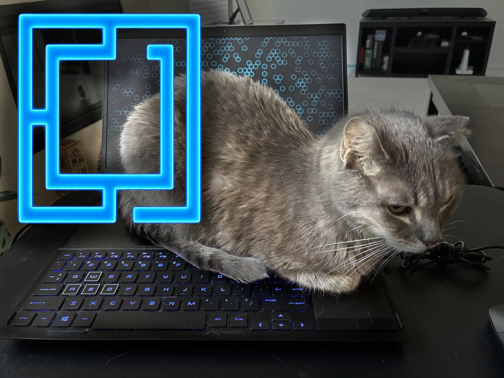

<p align="center">
  
</p>

# catclawedcode / CatLock

A cat-proof keyboard lock for Linux. Hit a hotkey combo when you see the
cat coming, and your keyboard stops sending anything to the OS - no
accidental keystrokes, no unsaved-work chaos, no cat-typed Slack messages
- while your screen, mouse/trackpad, and everything else keep working
normally. Hold the same combo again to unlock.

## How it works

CatLock exclusively "grabs" one physical keyboard device at the kernel
input (evdev) level and re-emits every event, unchanged, on a virtual
keyboard device it creates with `uinput`. That virtual device is what
your compositor/desktop actually sees, so from the OS's point of view
nothing changes.

While **unlocked**, every keystroke is forwarded through immediately -
you shouldn't notice CatLock is running at all.

When you hold the configured key combo for a set duration (default:
1.5s; set `hold_seconds: 0` to fire the instant all keys are down, no
hold required), CatLock stops forwarding events from that device. Cat
walks, sits, or naps on the keyboard: nothing gets through. Holding the
same combo again for the same duration resumes forwarding. The hold
timer is checked on a steady poll independent of new key events, so it
still fires correctly even if you hold the combo perfectly still with no
other keys changing state in between.

Because the grab happens *before* your compositor ever sees the raw
device, the hotkey has to be recognized by CatLock itself - it cannot be
a normal Hyprland/window-manager keybind on that keyboard, since Hyprland
only ever sees the virtual passthrough device once CatLock is running.

This is the same general technique used by key remappers like `keyd` and
`interception-tools`, just scoped to one narrow job.

## Platform scope

Developed and tested on **Omarchy** (Arch Linux + Hyprland, Wayland).
The core mechanism (`python-evdev` + `uinput`) is a Linux kernel-level
facility, not a Hyprland or Wayland feature, so this should work
unmodified on other Wayland compositors, X11 desktops, and other Linux
distros with evdev/uinput support. It has **not** been tested outside
Omarchy - if you try it elsewhere, please open an issue with what did or
didn't work.

This will **not** work on macOS or Windows; it depends on Linux's
`/dev/input` and `/dev/uinput` interfaces.

## Before you trust this daemon

Read this before relying on CatLock to protect real work:

- **This has the same capabilities as a keylogger / input-injection
  tool.** Grabbing a raw input device and creating a virtual one are
  exactly the primitives a malicious keylogger would use. Read
  `catlock.py` yourself before running it - it's a few hundred lines by
  design, so that this is realistic to do.
- **A bug or crash could leave the keyboard non-functional** until the
  process is restarted. CatLock installs signal handlers to release its
  grab cleanly on `SIGINT`/`SIGTERM`, and the provided systemd unit
  restarts it automatically on failure - but no such handling is
  bulletproof.
- **Test extensively before you rely on it.** Toggle lock/unlock
  dozens of times, with different held-down durations, before trusting
  it during real work. Keep an external USB keyboard, or SSH access from
  another machine, available the first several days in case you need to
  `pkill -f catlock.py` to get your keyboard back. (Your mouse/trackpad
  alone won't get you out of a stuck lock - you need another keyboard or
  a remote shell.)
- **Identify your device carefully.** Use `python3 catlock.py --identify`
  (see "Finding the right device" below) rather than guessing a
  `device_name` substring - some keyboards expose multiple identically-
  named `/dev/input/eventN` nodes where only one is real, and a
  substring match can silently grab the wrong one. Also make sure
  whatever you target is only your intended keyboard, especially on a
  machine anyone else might use, or where you might plug in an external
  keyboard you'd forget is also being grabbed.
- Locking only affects the one device CatLock grabs. It has no effect on
  screen lock, power button, or anything else - by design, so the screen
  stays alive and you can keep watching whatever's running.

## Requirements

- Linux with `/dev/input` and `/dev/uinput` (standard on any modern
  distro)
- Python 3.9+
- Python packages: `evdev`, `PyYAML` (see `requirements.txt`)
- `notify-send` (optional, for lock/unlock desktop notifications)
- One of `pw-play`, `paplay`, `aplay`, or `ffplay` (optional, for the
  lock/unlock sound - Omarchy ships PipeWire, so `pw-play` is already
  present)

## Installation

```sh
cd catclawedcode
./install.sh
```

The installer is interactive and asks before every step that needs
`sudo` or touches system config. It will:

1. Install `evdev`/`PyYAML` - via `pacman -S python-evdev python-yaml` on
   Arch/Omarchy (both are in the official `extra` repo, avoiding pip and
   Arch's PEP-668 "externally managed" restriction entirely), or via
   `pip install --user` elsewhere
2. Copy `config.example.yaml` to `config.yaml` if you don't have one yet
3. Optionally install a udev rule granting your user's `input` group
   access to `/dev/uinput`, so CatLock doesn't need to run as root
4. Optionally add you to the `input` group (needed for `/dev/input`
   read access) - **requires logging out and back in** to take effect
5. Optionally install (but not enable) a systemd `--user` service

### Manual installation

If you'd rather do it by hand or the installer doesn't fit your setup:

```sh
# Arch/Omarchy:
sudo pacman -S python-evdev python-yaml
# Elsewhere (or if you'd rather not touch system packages at all):
#   python3 -m venv .venv && ./.venv/bin/pip install -r requirements.txt
#   (then run everything below with ./.venv/bin/python instead of python3,
#   and update ExecStart in systemd/catlock.service accordingly)

cp config.example.yaml config.yaml

# identify your keyboard (see "Finding the right device" below) and set
# device_path (preferred) or device_name in config.yaml accordingly
python3 catlock.py --identify

# uinput permissions, so you don't need root
sudo cp udev/99-catlock-uinput.rules /etc/udev/rules.d/
sudo udevadm control --reload-rules && sudo udevadm trigger
sudo usermod -aG input "$USER"   # then log out and back in

# test it by hand first
python3 catlock.py --config config.yaml -v
```

### Permissions

CatLock needs:

- Read access to the specific `/dev/input/eventX` node for your
  keyboard - normally granted to the `input` group by distro-default
  udev rules.
- Read/write access to `/dev/uinput` - not granted by group membership
  by default; the provided udev rule (`udev/99-catlock-uinput.rules`)
  fixes that for the `input` group.

If you'd rather not touch udev/group config at all, you can instead run
CatLock as root (e.g. a system-level systemd unit with `User=root`), but
group-based permissions are preferred: it's the same privilege scope
CatLock actually needs, no more.

## Configuration

Copy `config.example.yaml` to `config.yaml` and edit:

| Key            | Meaning                                                            |
|----------------|---------------------------------------------------------------------|
| `device_path`  | Stable `/dev/input/by-id/...` symlink to grab (preferred - see below) |
| `device_name`  | Case-insensitive substring match against the keyboard's evdev name; only used if `device_path` is unset |
| `lock_keys`    | List of `evdev.ecodes` `KEY_*` names, all held together, to lock   |
| `unlock_keys`  | Same, to unlock (defaults to the same combo as `lock_keys`)        |
| `hold_seconds` | How long the combo must be held before it triggers                 |
| `notify`       | Send a desktop notification via `notify-send` on lock/unlock       |
| `sound`        | Play a sound (a meow, by default) on every lock/unlock             |
| `sound_file`   | Path to the sound file; relative paths resolve against this repo   |
| `log_file`     | Optional extra log file path, besides stdout                       |

### Sound

`sounds/meow.wav` is a small placeholder cat-meow synthesized locally in
Python (`sounds/generate_meow.py` - pitch sweep + light vibrato, no
external assets, no internet, no licensing questions). It's a stylized
chirp, not a real recording. Swap it for a real meow (or any sound)
anytime by pointing `sound_file` in `config.yaml` at your own file - no
code changes needed. To regenerate/tweak the placeholder itself, edit
and re-run `sounds/generate_meow.py`.

Playback tries, in order: `pw-play`, `paplay`, `aplay`, `ffplay` -
whichever is first found on `PATH`. It's fire-and-forget (non-blocking),
so a slow or missing player never delays the actual lock/unlock.

### Finding the right device

```sh
python3 catlock.py --identify
```

Type on the keyboard you want CatLock to grab when it says to. It
watches every input device at once, reports which one(s) actually saw
your keystrokes, and prints the exact `device_path` (or `device_name` as
a fallback) to paste into `config.yaml`.

Use `--identify` instead of guessing from `--list-devices` alone,
especially on gaming/RGB keyboards: **some keyboards - including some
laptops' own built-in keyboards - expose several `/dev/input/eventN`
nodes under the exact same device name**, where only one actually
carries real keystrokes and the others are silent secondary HID report
interfaces (extra media keys, macro layers, etc). Matching by
`device_name` alone can't tell these apart and may silently grab a node
that never receives anything - CatLock would run, report success, and
simply never see your keypresses. `--list-devices` flags this case when
it detects duplicate names, but `--identify` is what actually resolves
it, by watching for which node lights up when you type. This is also
why "AT Translated Set 2 keyboard" (the classic PS/2-style name) isn't
a safe universal default - some laptops (particularly gaming laptops)
route their built-in keyboard through a USB HID controller instead,
under a completely different, sometimes-duplicated name.

`--identify` prefers a `/dev/input/by-id/...` symlink when one exists,
since those are stable across reboots (unlike raw `/dev/input/eventN`
numbers, which can shift). Set `device_path` to that value in
`config.yaml` and it takes priority over `device_name` automatically.

## Running

By hand, in a terminal, with verbose logging while you test:

```sh
python3 catlock.py --config config.yaml -v
```

Hold your configured combo for `hold_seconds` to lock; hold it again to
unlock. Watch the log output to confirm each toggle and its reason.

### Running as a service

Once you've tested manually and are confident in your config:

```sh
systemctl --user enable --now catlock.service
journalctl --user -u catlock.service -f   # watch logs
```

`install.sh` copies `systemd/catlock.service` into
`~/.config/systemd/user/` with the correct absolute paths filled in, but
does not enable or start it for you - that's a deliberate manual step
once you trust your setup.

To stop relying on it entirely:

```sh
systemctl --user disable --now catlock.service
```

## Optional: status indicator (Waybar, etc.)

CatLock logs every lock/unlock with a timestamp and reason via the
standard `logging` module (journal, stdout, and/or `log_file`). If you
want a live on-screen indicator (e.g. in Waybar) rather than relying on
the notification, the simplest approach is to have your own small
wrapper script `tail -f` the log for the most recent `LOCKED`/`unlocked`
line and expose that as a Waybar custom module. This isn't bundled here
to keep the core tool minimal - happy to take a PR that adds a state
file if that's useful to you.

## Troubleshooting

- **`--list-devices`/`--identify` show nothing at all** - make sure
  you're in the `input` group (`id -nG`) and have **logged out and back
  in (or rebooted)** since being added. Group membership is fixed at
  login time - `usermod -aG` doesn't affect an already-running session,
  including an already-running `systemd --user` instance, so the service
  can keep failing even after `install.sh` succeeds until you do this.
- **Service fails immediately with `no input device matched name
  substring '...'`** - `device_name` doesn't match anything accessible.
  Run `python3 catlock.py --identify` and use the value it prints. If
  the service crash-loops on this and systemd reports
  `start-limit-hit`, fix the config first, then clear the lockout:
  `systemctl --user reset-failed catlock.service` before restarting.
- **Service starts fine, grabs a device, but the combo never does
  anything** - almost always means it grabbed the *wrong* device node.
  This happens on keyboards (including some laptops' own built-in ones)
  that expose several identically-named `/dev/input/eventN` nodes where
  only one carries real keystrokes - `device_name` substring matching
  can't tell them apart. Run `python3 catlock.py --identify`, type on
  your actual keyboard when prompted, and use the `device_path` it
  prints (takes priority over `device_name` automatically). Run with
  `-v` and watch `journalctl --user -u catlock.service -f` while you
  type - if you see zero `key ... down/up` debug lines while typing
  normally, that's the confirming symptom.
- **`PermissionError` on startup** - see the "Permissions" section
  above; you likely need the udev rule and/or `input` group membership.
- **Keyboard seems stuck locked** - from another device or SSH session,
  run `pkill -f catlock.py`; CatLock's exit handler releases its grab.
  If it was killed with `SIGKILL` (`-9`) instead of a normal signal, the
  grab may need `sudo fuser -k /dev/input/eventX` or a reboot as a last
  resort - this is why testing thoroughly before relying on it matters.
  Since lock state is never persisted to disk, restarting the service
  (or rebooting) always comes back unlocked - it can never boot up
  already stuck locked.
- **Modifier keys seem stuck after toggling** - please open an issue
  with your config and the `-v` log output around the toggle; this is
  exactly the class of bug the "release all keys on lock" / "wait for
  clean release on unlock" logic in `catlock.py` is meant to prevent.

## License

MIT - see `LICENSE`.
